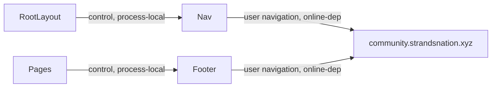

# StrandsNation codebase wiki

## Shared page shell and response headers

- `src/app/layout.tsx` is the Next.js App Router root layout. Its `<head>` is shared by the public pages and currently holds the EWDS boot script and structured data.
- `next.config.mjs` sets response headers for `/(.*)`. Its Content Security Policy controls external scripts and beacon requests for the site.
- The site is deployed on Vercel at `strandsnation.xyz`. A Cloudflare Web Analytics site using JS Snippet installation needs its beacon in the root layout, `https://static.cloudflareinsights.com` in `script-src`, and `https://cloudflareinsights.com` in `connect-src`.
- Keep analytics in the shared shell so page routes are counted consistently. Verify the rendered script, response CSP, and browser request on the live Vercel deployment after release.

Source checked against Git commit `d1eab77b801216854b392bb044d37a880fe97012` on 2026-09-27 SGT. `ARCHITECTURE.md` describes the root layout but its route inventory is stale; this section covers only the shared shell and response headers.

## Community forum links, 2026-11-16 SGT

Author: Codex desktop, GPT-6 (gpt-6).

Status: UNBUILT. Add a Community link to the shared navigation and footer, targeting `https://community.strandsnation.xyz`. Publication waits until that destination is available.

### Navigation (`src/components/Nav/Nav.tsx`, `Nav.module.css`)

Purpose: the shared page navigation renders the module's constant link list and closes its responsive menu after a selection. `RootLayout` calls `Nav` inside `Suspense`; `Nav` reads pathname/search parameters and owns only the menu-open state. Existing embed mode hides the whole navigation. External links use anchors with `noopener noreferrer`; the Community entry follows that existing path. The extra link must remain reachable without clipping on narrower desktop and mobile widths.

### Footer (`src/components/Footer/Footer.tsx`, `Footer.module.css`)

Purpose: the shared footer renders the site creed, copyright and Community destination. Page components compose this stateless server component. The link uses existing site colour/font tokens and a visible keyboard focus treatment.

The forum is a necessary online dependency for community discussions; no site content or credentials are sent by rendering these links. This change does not implement forum authentication, permissions or hosting.

Rendered check: the existing mobile menu's `top`/`bottom` sizing resolves against the filtered 56 px navigation container, clipping its upper links when open. Give the open-menu layer an explicit viewport-based height. Switch to the menu below 1024 px so the added destination does not compete with the logo and music controls on narrow desktop screens.

Drift: the main checkout has uncommitted August relocation edits and its HEAD predates remote production. This work starts from remote production commit `6cc22bb1cc100431c364248f0d96492c75d4d686` in a separate worktree, preserving that checkout. The architecture route inventory remains historical and is outside this link-only change.

### Verified outcome, 2026-11-16 SGT

BUILT locally by Codex desktop, GPT-6 (gpt-6). Nav and Footer both target the forum. Production build passed. Playwright rendered checks at 1440x900, 1024x768, 820x900 and 390x844 found no horizontal overflow; the 390px menu opens with all nine destinations inside the viewport. The mobile menu has explicit viewport-based height and is used below 1024px. Footer and menu destination attributes match. Console: zero errors, one existing Windows WebGPU warning. No production publication while the forum is unavailable. Receipt: `docs/receipts/COMMUNITY_LINK_20261116.md`.

## Community banner, 2026-11-17 SGT

Codex desktop, GPT-6 (gpt-6). Sean additionally requests a visible banner plus the Community menu item. Under Navigation contract above, Nav renders a native full-width Community forum anchor after the fixed navigation, with existing typography/colour tokens and keyboard focus. Its normal-flow top margin reserves the fixed56px navigation;44px minimum banner height provides a touch target. Existing embed=true path hides both nav andbanner. Mobile menu continues to overlay page content, including the banner. No auth, forms, hosting or user data changes. Read full Nav.tsx/Nav.module.css and RootLayout/MainWrapper callchain beforeedit; no separate component/state pipeline added. Verify desktop/mobile and embedded-route hiding.
